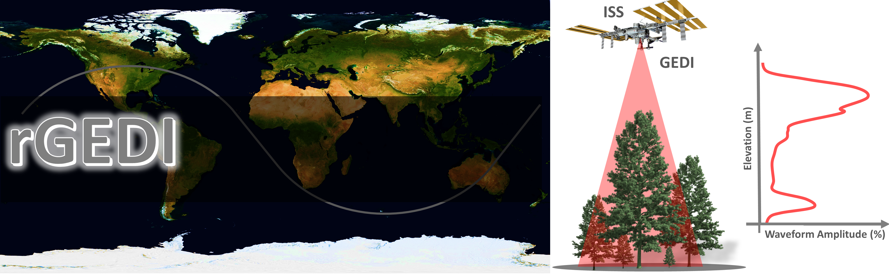
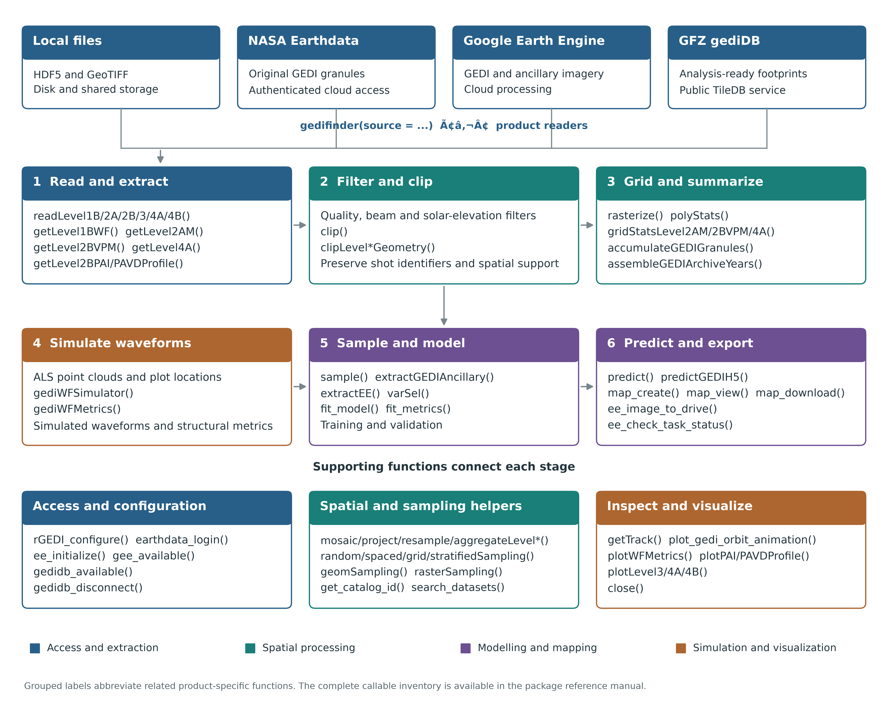
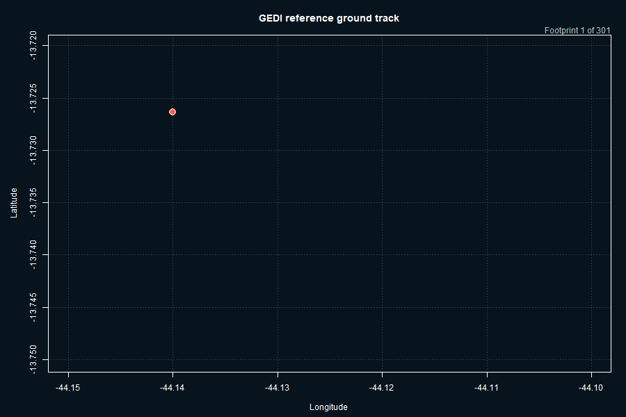
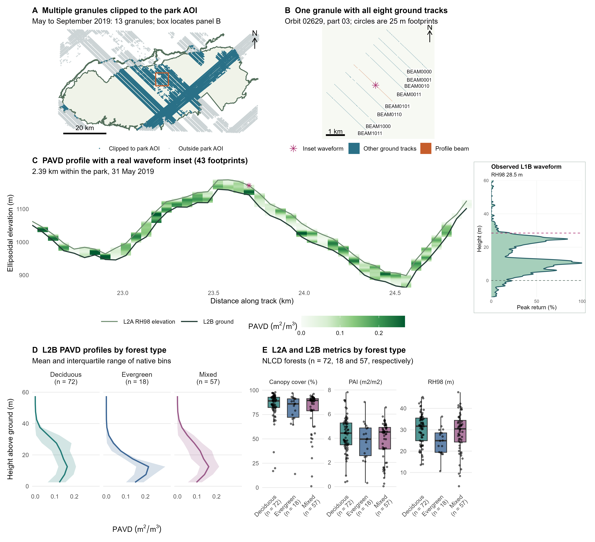
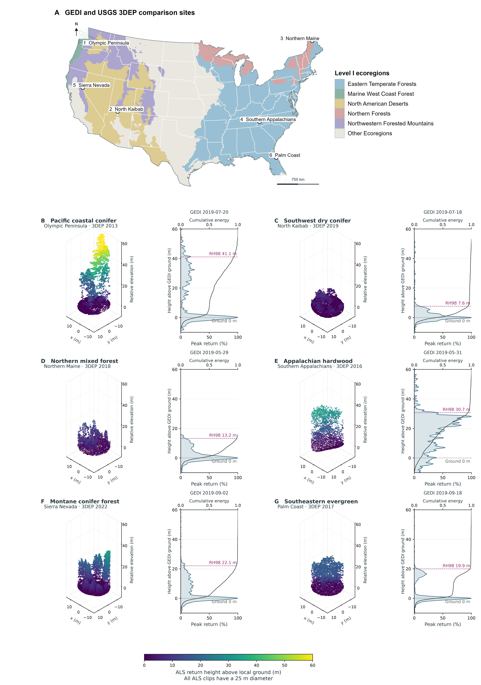
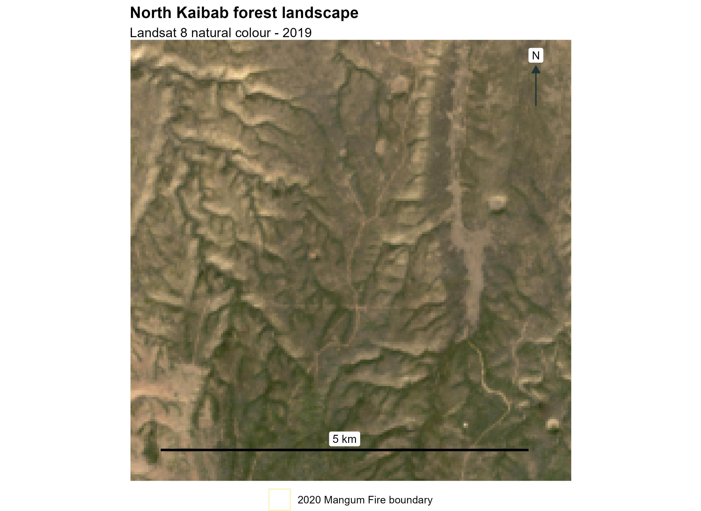
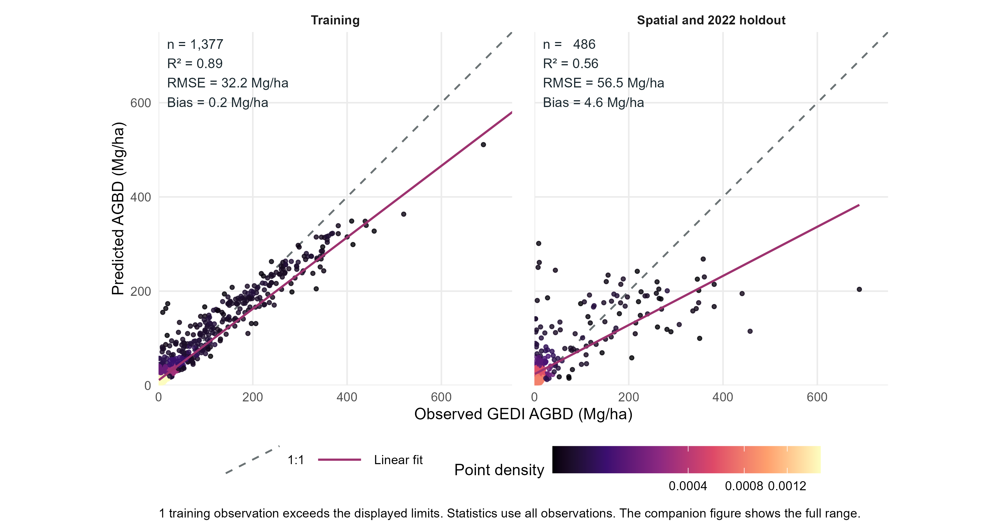
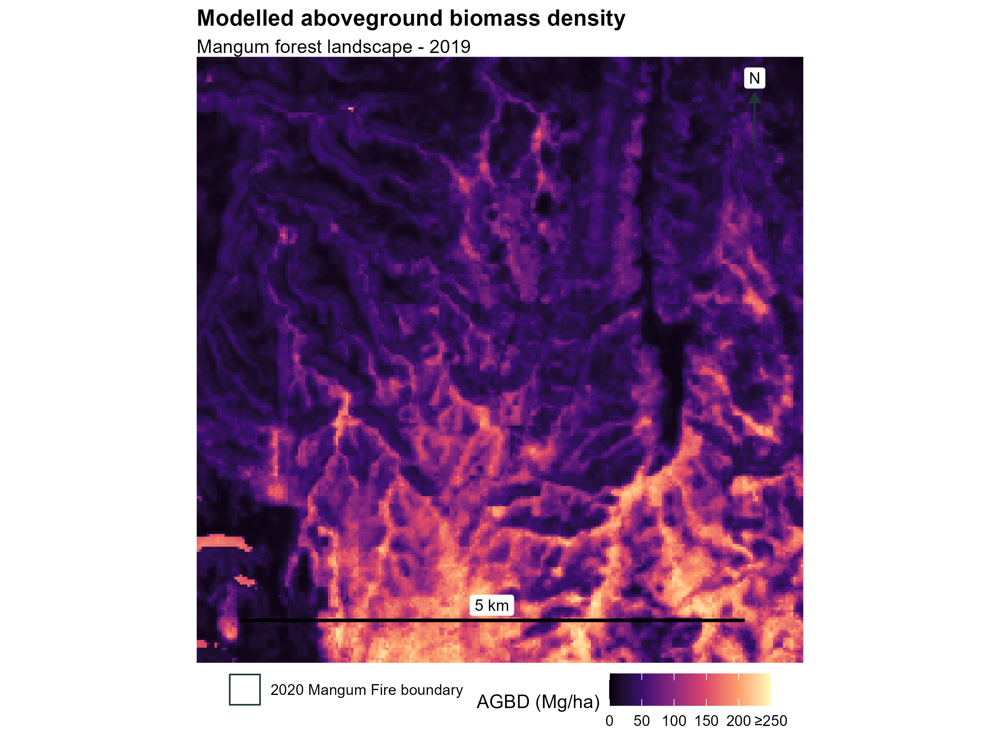

<br/>

<!-- badges: start -->
[](https://CRAN.R-project.org/package=rGEDI)


[](https://cran.r-project.org/package=rGEDI)
<!-- badges: end -->

**rGEDI: An R Package for NASA's Global Ecosystem Dynamics Investigation
(GEDI) Data Visualizing and Processing.**

Authors: Carlos Alberto Silva and Caio Hamamura.

The original rGEDI workflow provides functions for downloading, visualizing,
clipping, gridding, simulating, and exporting GEDI data. The expanded package
also searches, streams, filters, summarizes, models, and maps NASA GEDI data.

`rGEDI` searches, downloads, streams, reads, filters, clips, summarizes,
simulates, models, and maps NASA Global Ecosystem Dynamics Investigation
(GEDI) data. It supports footprint products GEDI01_B, GEDI02_A, GEDI02_B,
and GEDI04_A, as well as raster products GEDI03 and GEDI04_B.

The examples below form one workflow. Local examples use the real GEDI subsets
bundled with the package. Cloud and Google Earth Engine examples use real NASA
and Earth Engine services. Reproduction instructions and input provenance for the figures are in
[`readme/REPRODUCE.md`](readme/REPRODUCE.md). A
generated function reference manual is available at
`output/pdf/rGEDI-reference-manual.pdf`.

<p align="center"></p>

Editable PowerPoint figures and the full plotting scripts are available in
[`readme/editable/`](readme/editable/) and
[`readme/REPRODUCE.md`](readme/REPRODUCE.md). The workflow diagram, waveforms,
reference lines and model scatter charts contain editable native objects.
Dense ALS and PAVD panels remain separate high-resolution image objects.

# Getting Started

## 1 Installation

```r
# Current development API used by these examples
install.packages("remotes")
remotes::install_github("carlos-alberto-silva/rGEDI")

# Alternative development builds, after the r-universe build completes
# install.packages("rGEDI", repos = c(
#   "https://carlos-alberto-silva.r-universe.dev",
#   "https://cloud.r-project.org"))

library(rGEDI)
library(data.table)
library(sf)
library(terra)
```

### Configure Python and Google Earth Engine

As in the ICESat2VegR workflow, rGEDI uses three Python packages through
`reticulate`:

1. [`earthaccess`](https://github.com/earthaccess-dev/earthaccess) finds and
   authenticates Earthdata Cloud objects.
2. [`h5py`](https://github.com/h5py/h5py) reads HDF5 content streamed from the
   cloud.
3. [`earthengine-api`](https://github.com/google/earthengine-api) samples
   predictors and creates wall-to-wall maps in Google Earth Engine.

Run the configuration once to install the optional Python modules through
reticulate. Set RETICULATE_PYTHON before loading reticulate when selecting
an existing environment. Add gedidb = TRUE to install the database backend.

```r
rGEDI_configure(install = TRUE)
ee_initialize(project = "your-google-cloud-project")
```

Verify the active Python and required modules:

```r
safely <- function(expr, default = NA) tryCatch(expr, error = function(e) default)
have_reticulate <- requireNamespace("reticulate", quietly = TRUE)
py_ready <- have_reticulate &&
  !inherits(try(reticulate::py_config(), silent = TRUE), "try-error")

status <- list(
  rGEDI_loaded = "package:rGEDI" %in% search(),
  python_used = if (have_reticulate)
    safely(reticulate::py_discover_config()$python) else NA,
  h5py = if (py_ready) reticulate::py_module_available("h5py") else FALSE,
  earthaccess = if (py_ready)
    reticulate::py_module_available("earthaccess") else FALSE,
  ee = if (py_ready) reticulate::py_module_available("ee") else FALSE
)
print(status)
```

## 2 Example study site

The package contains Cerrado forest stands and small matched GEDI Level 1B,
Level 2A, and Level 2B granules.

```r
stands_path <- system.file("extdata", "stands_cerrado.shp", package = "rGEDI")
study_area <- sf::st_read(stands_path, quiet = TRUE)
box <- sf::st_bbox(study_area)

xmin <- unname(box["xmin"]); xmax <- unname(box["xmax"])
ymin <- unname(box["ymin"]); ymax <- unname(box["ymax"])
daterange <- c("2019-04-18", "2019-04-19")
outdir <- file.path(tempdir(), "rGEDI")
dir.create(outdir, showWarnings = FALSE)
```

## 3 Find GEDI data and download

### 3.1 Find GEDI granules

`gedifinder()` queries NASA CMR. Use the official short names and current
versions. The returned character vector contains direct HTTPS links.

```r
products <- c(
  GEDI01_B = "002", GEDI02_A = "002", GEDI02_B = "002",
  GEDI03 = "001", GEDI04_A = "003", GEDI04_B = "002"
)

granules <- lapply(names(products), function(product) {
  gedifinder(
    product,
    ul_lat = ymax, ul_lon = xmin,
    lr_lat = ymin, lr_lon = xmax,
    version = products[[product]], daterange = daterange,
    cloud_computing = FALSE, persist = TRUE
  )
})
names(granules) <- names(products)
head(granules$GEDI02_A)
```

To retrieve every production granule in one orbit, supply its orbit number
instead of a bounding box. CMR returns the four parts in acquisition order.

```r
orbit_granules <- gedifinder(
  "GEDI02_A", version = "002", orbit = "O01964", return = "table"
)
orbit_granules[, c("granule_id", "orbit", "granule_part")]
stopifnot(nrow(orbit_granules) == 4L)
```

Set `cloud_computing = TRUE` for cloud-hosted links suitable for streaming.
An HTTPS Earthdata Cloud URL works on Windows, macOS, and Linux. Direct
`s3://` reads require code running in AWS `us-west-2`, which is a NASA bucket
policy rather than an operating-system limitation.

### 3.2 Download the granules

Keep credentials outside scripts. `earthdata_login()` can use a standard
`~/.netrc`, the `NETRC` environment variable, or a path passed at run time.

```r
# Sys.setenv(NETRC = "/secure/path/to/.netrc")
earthdata_login()

gediDownload(granules$GEDI01_B[1], outdir)
gediDownload(granules$GEDI02_A[1], outdir)
gediDownload(granules$GEDI02_B[1], outdir)
gediDownload(granules$GEDI04_A[1], outdir)

# GEDI03 and GEDI04_B searches may return several metric GeoTIFFs.
gediDownload(granules$GEDI03[1], outdir)
gediDownload(granules$GEDI04_B[1], outdir)
```

`gediDownload()` accepts the complete URL vector and invisibly returns the
downloaded paths. Orbit `O01964` is about 9.2 GB, so ensure sufficient disk
space before running this example.

```r
orbit_files <- gediDownload(orbit_granules$url, outdir)
```

## 4 Read GEDI products

### Read downloaded products

```r
level1b_file <- list.files(outdir, "GEDI01_B.*\\.h5$", full.names = TRUE)[1]
level2a_file <- list.files(outdir, "GEDI02_A.*\\.h5$", full.names = TRUE)[1]
level2b_file <- list.files(outdir, "GEDI02_B.*\\.h5$", full.names = TRUE)[1]
level4a_file <- list.files(outdir, "GEDI04_A.*\\.h5$", full.names = TRUE)[1]
level3_file  <- list.files(outdir, "GEDI03.*\\.tif$", full.names = TRUE)[1]
level4b_file <- list.files(outdir, "GEDI04_B.*\\.tif$", full.names = TRUE)[1]

level1b_full <- readLevel1B(level1b_file)
level2a_full <- readLevel2A(level2a_file)
level2b_full <- readLevel2B(level2b_file)
level3  <- readLevel3(level3_file)
level4a_full <- readLevel4A(level4a_file)
level4b <- readLevel4B(level4b_file)
```

The bundled subsets can be opened without a network connection:

```r
level1b_path <- unzip(system.file("extdata",
  "GEDI01_B_2019108080338_O01964_T05337_02_003_01_sub.zip",
  package = "rGEDI"), exdir = outdir)
level2a_path <- unzip(system.file("extdata",
  "GEDI02_A_2019108080338_O01964_T05337_02_001_01_sub.zip",
  package = "rGEDI"), exdir = outdir)
level2b_path <- unzip(system.file("extdata",
  "GEDI02_B_2019108080338_O01964_T05337_02_001_01_sub.zip",
  package = "rGEDI"), exdir = outdir)

level1b <- readLevel1B(level1b_path)
level2a <- readLevel2A(level2a_path)
level2b <- readLevel2B(level2b_path)
```

### Stream GEDI HDF5 data from Earthdata Cloud

```r
cloud_urls <- gedifinder(
  "GEDI04_A",
  ul_lat = ymax, ul_lon = xmin, lr_lat = ymin, lr_lon = xmax,
  version = "003", daterange = daterange,
  cloud_computing = TRUE, persist = TRUE
)

# readLevel1B(), readLevel2A(), and readLevel2B() accept the same URL type.
level4a_cloud <- readLevel4A(cloud_urls[1])
class(level4a_cloud)
```

Level 3 and Level 4B are raster collections. Download the selected metric
GeoTIFF first and then use `readLevel3()` or `readLevel4B()`. This avoids the
Earthdata redirect restrictions encountered by GDAL virtual-file reads.

### Stream footprint products from gediDB

[gediDB](https://gedidb.readthedocs.io/en/latest/user/tiledb_database.html)
provides a public, analysis-ready TileDB database for GEDI Level 2A, Level 2B,
Level 4A, and Level 4C. It does not require NASA credentials. Install the
optional Python backend once:

~~~r
rGEDI_configure(gedidb = TRUE, install = TRUE)
~~~

Select source = "gedidb" during the search. The finder checks the service and
returns only a lazy remote reference; it does not transfer footprints. The
read function opens that reference, and the extraction function requests the
selected variables.

~~~r
l2a_address <- gedifinder(
  "GEDI02_A",
  ul_lat = ymax, ul_lon = xmin, lr_lat = ymin, lr_lon = xmax,
  version = "003", daterange = daterange, source = "gedidb"
)
l2a_remote <- readLevel2A(l2a_address)
l2a_rh98 <- getLevel2AM(l2a_remote, rh = 98, quality = TRUE)

l4a_address <- gedifinder(
  "GEDI04_A",
  ul_lat = ymax, ul_lon = xmin, lr_lat = ymin, lr_lon = xmax,
  version = "003", daterange = daterange, source = "gedidb"
)
l4a_remote <- readLevel4A(l4a_address)
l4a_agbd <- getLevel4A(
  l4a_remote,
  cols = c("shot_number", "agbd", "agbd_se", "l4a_quality_flag_rel3"),
  quality = TRUE
)
~~~

The results are ordinary data.table footprint tables, so the same clipping,
sampling, rasterization, statistics, and modeling functions apply. For an
exact 1 km grid, supply a projected SpatRaster template:

~~~r
grid_points <- rbind(
  l2a_rh98[, .(lon_lowestmode, lat_lowestmode)],
  l4a_agbd[, .(lon_lowestmode, lat_lowestmode)]
)
grid_points <- terra::vect(
  as.data.frame(grid_points),
  geom = c("lon_lowestmode", "lat_lowestmode"), crs = "EPSG:4326"
)
grid_points <- terra::project(grid_points, "EPSG:6933")
bounds <- as.vector(terra::ext(grid_points))
bounds <- c(
  floor(bounds[1] / 1000) * 1000, ceiling(bounds[2] / 1000) * 1000,
  floor(bounds[3] / 1000) * 1000, ceiling(bounds[4] / 1000) * 1000
)
template_1km <- terra::rast(
  terra::ext(bounds),
  resolution = 1000, crs = "EPSG:6933"
)

rh98_1km <- rasterize(l2a_rh98, "rh98", template = template_1km)
agbd_1km <- rasterize(l4a_agbd, "agbd", template = template_1km)
~~~

The first query in an R session opens remote TileDB metadata. Later queries
reuse a cached provider. Call gedidb_disconnect() when the remote workflow is
finished.

For larger areas, retain a lazy gediDB query and process independent spatial
tiles concurrently. Each worker downloads only the selected metric,
coordinates, and quality fields and immediately reduces the footprints to
grid-cell totals. Supplying `filename` keeps large rasters disk-backed.

~~~r
l2a_rh98_lazy <- getLevel2AM(
  l2a_remote, rh = 98, quality = TRUE, collect = FALSE
)

rh98_parallel_1km <- rasterize(
  l2a_rh98_lazy, "rh98",
  res = 1000, output_crs = "EPSG:6933",
  parallel = TRUE, workers = 2, tile_size = 1,
  filename = file.path(outdir, "gedidb_rh98_1km.tif")
)
~~~

Use a small number of workers first. Every worker opens an independent remote
TileDB connection, so excessive parallelism can reduce performance or overload
the public service. A mission-wide grid covers billions of footprints and
should be treated as a resumable cloud/HPC batch job, not an interactive query.

The same parallel controls are available when extracting a collection of
independent granules. Each worker opens and closes its own HDF5 connection.

~~~r
level2a_collection <- readLevel2A(orbit_files)
metrics <- getLevel2AM(
  level2a_collection, rh = 98, quality = TRUE,
  parallel = TRUE, workers = 2
)
close(level2a_collection)
~~~

gediWFSimulator() also accepts multiple footprint centres and the optional
arguments parallel, workers, and seed. accumulateGEDIGranules() accepts a
manifest table for parallel accumulation. Keep concurrency modest when
several workflows share memory and network bandwidth.

Parallelism is intentionally not applied to a single open HDF5 object or to
Google Earth Engine operations. Earth Engine already executes computations on
Google's servers, while sharing local HDF5 handles between processes is unsafe.

### Search and process GEDI with Google Earth Engine

The same finder-reader-extractor sequence also works with Google Earth Engine.
Initialize the project once per R session, then select `source = "gee"`.
Unlike Earthdata and gediDB, Earth Engine currently serves GEDI Version 2
(Level 2A/2B and Level 4B) and Version 2.1 (Level 4A), so rGEDI validates the
version and records it in the returned reference.

~~~r
ee_initialize(project = Sys.getenv("EE_PROJECT"))

l2a_gee_address <- gedifinder(
  "GEDI02_A",
  ul_lat = ymax, ul_lon = xmin, lr_lat = ymin, lr_lon = xmax,
  version = "002", daterange = daterange, source = "gee"
)
l2a_gee <- readLevel2A(l2a_gee_address)

# Collect a bounded footprint query as a data.table.
l2a_rh98_gee <- getLevel2AM(
  l2a_gee, rh = 98, quality = TRUE, max_features = 100000
)

# Or leave the footprints in Earth Engine and build the 1 km grid there.
l2a_rh98_lazy <- getLevel2AM(
  l2a_gee, rh = 98, quality = TRUE, collect = FALSE
)
rh98_1km_gee <- rasterize(
  l2a_rh98_lazy, "rh98", res = 1000, fun = "mean", output_crs = "EPSG:3857"
)

l4a_gee_address <- gedifinder(
  "GEDI04_A",
  ul_lat = ymax, ul_lon = xmin, lr_lat = ymin, lr_lon = xmax,
  version = "002.1", daterange = daterange, source = "gee"
)
l4a_gee <- readLevel4A(l4a_gee_address)
l4a_agbd_lazy <- getLevel4A(
  l4a_gee, cols = "agbd", quality = TRUE, collect = FALSE
)
agbd_1km_gee <- rasterize(
  l4a_agbd_lazy, "agbd", res = 1000, fun = "mean", output_crs = "EPSG:3857"
)
~~~

`gedifinder()` checks that the selected service is reachable before later
functions run. `clip()` preserves a lazy GEE object, and `getTileUrl()`,
`map_view()`, `map_download()`, and `ee_image_to_drive()` accept the lazy
raster result directly. The Web Mercator example uses 1,000 projected metres;
choose an appropriate local metric or equal-area CRS for analysis because
Web Mercator cell areas vary with latitude. Use `collect = TRUE` only for focused footprint
queries; use `collect = FALSE` for large-area gridding and mapping.

## 5 Extract, quality-filter, clip, rasterize, summarize, and simulate footprint-level products

### 5.1 Extract the Reference Ground Track and plot the GIF animation

`getTrack()` standardizes coordinates, beam names, and acquisition order
from a Level 1B, 2A, 2B, or 4A object, an extracted table, or a list of open
granules. NASA partitions one GEDI orbit into four consecutive production
granules (`_01` through `_04`). `gedifinder(orbit = ...)` retrieves every part;
`every` thins the display without changing acquisition order.

```r
stopifnot(length(orbit_files) == 4L)

orbit_h5 <- lapply(sort(orbit_files), readLevel2A)
rgt <- getTrack(orbit_h5, every = 200, segment_gaps = FALSE)
head(rgt)

plot_gedi_orbit_animation(
  orbit_h5,
  output_file = file.path(outdir, "gedi-orbit-animation.gif"),
  title = "GEDI aboard the International Space Station",
  duration = 8, every = 200, launch = FALSE
)

# Use .html for the interactive 3D globe.
plot_gedi_orbit_animation(
  orbit_h5, output_file = file.path(outdir, "gedi-orbit-animation.html"),
  every = 200,
  track_speed = 2, earth_rotation_speed = 2,
  launch = interactive()
)
```

The displayed example was generated from the four complete Level 2A V002
granules for orbit `O01964`. Its 22,350 sampled footprints span all eight GEDI
beams, four granule parts, 81.6 minutes, and latitudes from -50.346 to 51.825
degrees. The reproducible cloud-reading and animation script is
`readme/build-complete-orbit.R`.

The GIF follows the ICESat2VegR presentation while showing the correct GEDI
platform: GEDI is mounted on the International Space Station. GEDI operates at
1064 nm in the near infrared; the red beam and track visualize that invisible
laser pulse and connect the ISS payload to the accumulating reference ground
track. Every displayed ISS position follows the time-ordered geolocation from
the most complete beam in the open HDF5 granule. Following the ICESat2VegR
animation, the textured Earth rotates independently while the NASA ISS image,
GEDI payload label, red laser, and red orbit track move together in 3D. The
HTML controls adjust both track playback and Earth rotation speed.

<p align="center"></p>

### 5.2 Extract the data

#### Get GEDI pulse geolocation (GEDI Level 1B)

```r
level1b_geo <- getLevel1BGeo(level1b)
head(level1b_geo)
```

The U.S. comparison below connects footprint geolocation to real GEDI
returns and measured airborne lidar structure.


#### Get GEDI full waveform (GEDI Level 1B)

```r
shot <- level1b_geo$shot_number[1]
waveform <- getLevel1BWF(level1b, shot_number = shot)
plot(waveform)
```


#### Get GEDI elevation and height metrics (GEDI Level 2A)

```r
level2a_metrics <- getLevel2AM(level2a)
level2a_good <- level2a_metrics[
  quality_flag == 1 & degrade_flag == 0 & sensitivity >= 0.9
]
level2a_good[, .(beam, shot_number, elev_lowestmode, rh50, rh90, rh98, rh100)]
```

#### Plot waveform with RH metrics

```r
plotWFMetrics(level1b, level2a, shot_number = shot,
              rh = c(25, 50, 75, 90, 98))
```


#### Get GEDI vegetation biophysical variables (GEDI Level 2B)

```r
level2b_vpm <- getLevel2BVPM(level2b)
level2b_good <- level2b_vpm[l2b_quality_flag == 1 & sensitivity >= 0.9]
level2b_good[, .(beam, shot_number, rh100, pai, fhd_normal, cover)]
```

#### Get and plot PAI and PAVD profiles (GEDI Level 2B)

```r
pai_profile  <- getLevel2BPAIProfile(level2b)
pavd_profile <- getLevel2BPAVDProfile(level2b)
profile_beam <- unique(pai_profile$beam)[1]
plotPAIProfile(pai_profile, beam = profile_beam)
plotPAVDProfile(pavd_profile, beam = profile_beam)
```

The Appalachian example connects footprint products, clipping, vegetation
profiles and forest characterization. Panel A shows 13 granules from May to
September 2019 clipped to the mapped Great Smoky Mountains National Park AOI.
Panel B shows all eight ground tracks of one Earthdata granule. Panel C shows
a continuous PAVD display with the actual Level 1B waveform from the marked
footprint in its inset. No background imagery is used.

```r
source("readme/build-profile-example.R")
```

<p align="center"></p>

The single-granule map contains 4,387 geolocated footprints across all eight
beams. Footprint circles have a nominal 25 m diameter. The highlighted
Level 2B beam contains 686 candidate shots, of which 167 pass its quality,
algorithm, degradation, sensitivity and vegetation-value screen. There are
166 inside the park, each with a valid matched Level 2A RH98 observation.
The continuous profile has 43 shots across 2.39 km. Its 925-bin inset waveform
comes from the marked shot, rather than an illustration from another site.

For display, the PAVD columns extend to the midpoints between footprint
centres, and their native 5 m vertical bins are interpolated within each
column. This produces a continuous display while retaining the original
measurements for summaries. It does not create new GEDI observations.
The transect shows L2B ground and the elevation of L2A RH98.

Panels D and E compare 72 deciduous, 18 evergreen and 57 mixed-forest
footprints classified by year-matched NLCD 2019 pixels. The vertical PAVD
panels share axes and show means and interquartile ranges from native bins,
including zeros. The boxplots show standard Level 2A RH98 and Level 2B canopy
cover and PAI. Nineteen other-cover footprints remain in the park-wide
summary and are omitted from these forest comparisons.

The overview uses GEE Level 2A V2 footprints. The single-granule map,
matched RH98 measurements, PAVD profiles and waveform use Earthdata V3.
The overview illustrates coverage. Numerical forest summaries use the
matched V3 observations. The [NPS boundary](https://www.nps.gov/grsm/planyourvisit/access_data.htm)
defines the AOI, and [USGS NLCD 2019](https://developers.google.com/earth-engine/datasets/catalog/USGS_NLCD_RELEASES_2019_REL_NLCD)
provides the forest classes. Cached inputs make redrawing the figure possible
without a cloud connection.

#### Get GEDI aboveground biomass at footprint level (GEDI Level 4A)

```r
level4a_footprints <- getLevel4A(
  level4a_cloud,
  cols = c("beam", "shot_number", "delta_time", "lat_lowestmode",
           "lon_lowestmode", "agbd", "agbd_se", "sensitivity",
           "l4a_quality_flag_rel3", "degrade_include_flag",
           "elev_highestreturn_outlier_flag"),
  quality = TRUE
)
head(level4a_footprints)
```

### U.S. forest waveforms and airborne lidar

Six real GEDI Level 1B waveforms illustrate Pacific coastal conifer,
southwest dry conifer, northern mixed forest, Appalachian hardwood,
Sierra Nevada montane conifer and southeastern evergreen forest settings. The
USGS 3DEP views show height-coloured ALS points over measured hillshaded DTM
surfaces. All point clouds share camera angle, horizontal extent, vertical
limits and colour scale. Waveforms share height and peak-return scales,
with labelled GEDI ground and RH98 lines. The top axis shows normalized
cumulative return energy integrated over the displayed -10 to 60 m interval.
This plotting calculation is separate from the mission's RH retrieval.
The ALS clips and hillshaded DTM surfaces have a 25 m diameter. An orthographic
view and translucent terrain keep the lower returns visible.

<p align="center"></p>

ALS and GEDI acquisition dates are shown. These observations illustrate
contrasting structure and are not a temporally matched ALS validation.
The plotting inputs and provenance are in `readme/data/us_forests/`.
Rebuild with `python readme/build-us-forest-figure.py`.

### 5.3 Clip

Use the generic `clip()` function for every GEDI product. A bounding box uses
the rGEDI/terra coordinate order `c(xmin, xmax, ymin, ymax)`; polygons can be
`sf`, `sfc`, or `SpatVector` objects.

```r
bbox <- c(xmin, xmax, ymin, ymax)

# Open HDF5 products
level1b_clip <- clip(level1b, bbox,
  output = file.path(outdir, "level1b-clip.h5"))
level2a_clip <- clip(level2a, bbox,
  output = file.path(outdir, "level2a-clip.h5"))
level2b_clip <- clip(level2b, study_area,
  output = file.path(outdir, "level2b-clip.h5"))
level4a_clip <- clip(level4a_cloud, bbox,
  output = file.path(outdir, "level4a-clip.h5"))

# Extracted footprint tables and rasters
level2a_bbox <- clip(level2a_metrics, bbox)
level4a_geom <- clip(level4a_footprints, study_area)
level3_aoi <- clip(level3, vect(study_area))
level4b_bbox <- clip(level4b, bbox)
```

The output type follows the input type: open HDF5 objects return open clipped
HDF5 objects, extracted tables return `data.table` objects, and Level 3/4B
rasters return `SpatRaster` objects. The product-specific functions shown below
remain available when an explicit function name is useful in a script.

#### Clip open GEDI HDF5 objects

Level 1B, 2A, 2B, and 4A clippers write valid subset HDF5 files and return
open GEDI objects. Passing an extracted table instead returns a `data.table`.

```r
level1b_clip <- clipLevel1B(level1b, xmin, xmax, ymin, ymax,
                            output = file.path(outdir, "level1b-clip.h5"))
level2a_clip <- clipLevel2A(level2a, xmin, xmax, ymin, ymax,
                            output = file.path(outdir, "level2a-clip.h5"))
level2b_clip <- clipLevel2B(level2b, xmin, xmax, ymin, ymax,
                            output = file.path(outdir, "level2b-clip.h5"))
level4a_clip <- clipLevel4A(level4a_cloud, xmin, xmax, ymin, ymax,
                            output = file.path(outdir, "level4a-clip.h5"))
level4a_table_clip <- clipLevel4A(level4a_footprints, xmin, xmax, ymin, ymax)
```

Clip the HDF5 products by geometry:

```r
level1b_geom <- clipLevel1BGeometry(level1b, study_area,
  output = file.path(outdir, "level1b-geometry"))
level2a_geom <- clipLevel2AGeometry(level2a, study_area,
  output = file.path(outdir, "level2a-geometry"))
level2b_geom <- clipLevel2BGeometry(level2b, study_area,
  output = file.path(outdir, "level2b-geometry"))
level4a_geom <- clipLevel4AGeometry(level4a_cloud, study_area,
  output = file.path(outdir, "level4a-geometry.h5"))
level4a_table_geom <- clipLevel4AGeometry(level4a_footprints, study_area)
```

#### Clip extracted `data.table` objects

```r
level1b_geo_bbox <- clipLevel1BGeo(level1b_geo, xmin, xmax, ymin, ymax)
level2a_bbox <- clipLevel2AM(level2a_metrics, xmin, xmax, ymin, ymax)
level2b_bbox <- clipLevel2BVPM(level2b_vpm, xmin, xmax, ymin, ymax)

level1b_geo_geom <- clipLevel1BGeoGeometry(level1b_geo, study_area)
level2a_geom_dt <- clipLevel2AMGeometry(level2a_metrics, study_area)
level2b_geom_dt <- clipLevel2BVPMGeometry(level2b_vpm, study_area)

plot(st_geometry(study_area))
points(level2a_geom_dt$lon_lowestmode, level2a_geom_dt$lat_lowestmode,
       pch = 16, col = "#762A83")
```

#### Characterize forest structure within polygons

The characterization figure in Section 5.2 demonstrates a clip to a named
national park followed by summaries within the AOI and by mapped forest type.
Supply your own mapped fire, stand or forest-type boundaries to apply the
same functions to other questions.

```r
# `polygons` contains a unit_id column and a defined CRS.
footprints <- clip(level2b_good, polygons, split_by = "unit_id")
structure_metrics <- function(pai, cover) list(
  n = length(pai), mean_pai = mean(pai), mean_cover = mean(cover)
)
polygon_summary <- polyStatsLevel2BVPM(
  footprints, ~structure_metrics(pai, cover), id = "poly_id"
)
```

The runnable park example writes `readme/profile-polygon-summary.csv` and
`readme/profile-forest-type-summary.csv`. These are summaries of sampled
footprints. Record sample counts and acquisition periods when interpreting
differences among forest types or disturbance classes.

### 5.4 Compute descriptive statistics

```r
metric_set <- function(x) c(
  n = sum(is.finite(x)), mean = mean(x, na.rm = TRUE),
  sd = sd(x, na.rm = TRUE), min = min(x, na.rm = TRUE),
  max = max(x, na.rm = TRUE)
)

rh98_stats <- polyStatsLevel2AM(
  level2a_geom_dt, func = metric_set(rh98), id = NULL
)
cover_stats <- polyStatsLevel2BVPM(
  level2b_geom_dt, func = metric_set(cover), id = NULL
)
agbd_stats <- polyStatsLevel4A(
  level4a_footprints, study_area, metric = "agbd", fun = metric_set
)
```

### 5.5 Compute grids with descriptive statistics

```r
rh98_grid <- gridStatsLevel2AM(
  level2a_metrics, func = mean(rh98, na.rm = TRUE), res = 0.002
)
cover_grid <- gridStatsLevel2BVPM(
  level2b_vpm, func = mean(cover, na.rm = TRUE), res = 0.002
)
agbd_grid <- gridStatsLevel4A(
  level4a_footprints, metric = "agbd", fun = mean,
  res = 0.002, na.rm = TRUE
)
```


### 5.6 Convert to `SpatVector`

`to_vect()` detects the standard coordinate fields for Level 2A, Level 2B,
and Level 4A tables.

```r
level2a_vect <- to_vect(level2a_metrics)
level2b_vect <- to_vect(level2b_vpm)
level4a_vect <- to_vect(level4a_footprints)
```

## 6 Modelling forest attributes

Section 9 provides a runnable forest biomass example using satellite-derived
predictors, separate spatial blocks and a held-out acquisition year. It uses
fit_model(), predict() and fit_metrics(), and reports training and validation
performance with the same plotting scales.

For a field response such as total fuel biomass or timber volume, join
measured plots to simulated waveform metrics using plot identifiers.
gediWFSimulator() and gediWFMetrics() provide the waveform predictors shown
in Section 8. Fit the model to the measured field response, and keep samples
from the same plot or stand together when assigning validation folds. Apply
varSel() within each training fold when predictor selection forms part of the
workflow. Record the field units alongside the predictions.

## 7 Extract, clip, and summarize GEDI-derived grid products

```r
level3 <- readLevel3(level3_file)
level4b <- readLevel4B(level4b_file)
```

### 7.1 Visualization

```r
plotLevel3(level3, main = "GEDI Level 3 metric")
plotLevel4B(level4b, main = "GEDI Level 4B AGBD")
```

### 7.2 Clip using a bounding box or geometry

```r
level3_bbox <- clipLevel3(level3, c(xmin, xmax, ymin, ymax))
level4b_bbox <- clipLevel4B(level4b, c(xmin, xmax, ymin, ymax))
level3_aoi <- clipLevel3(level3, vect(study_area))
level4b_aoi <- clipLevel4B(level4b, vect(study_area))
level3_values <- getLevel3(level3, geometry = vect(study_area))
level4b_values <- getLevel4B(level4b, geometry = vect(study_area))
```

### 7.3 Compute Level 4B descriptive statistics within an AOI

```r
level4b_stats <- polyStats(
  level4b, vect(study_area), fun = mean, na.rm = TRUE
)
level4b_stats
```

## 8 Simulating GEDI full-waveform data from ALS point clouds

`gediWFSimulator()` accepts LAS/LAZ files, `lidR::LAS` objects, `SpatVector`
points, or an X/Y/Z table. Its focused implementation follows Steven Hancock's
`gediRat` core: Gaussian footprint weighting, local ALS-density correction,
vertical binning, Gaussian pulse convolution, LAS class 2 ground separation,
and unit-integral normalization. Its supported waveform path is tested bin by
bin against a C reference extraction from upstream commit
`49ad4f26b03083b61ee0bd424e8a7e4a8f2c301d`, with agreement within `5e-7`.
Vectorized bin accumulation keeps this path portable and fast without the
native library stack that caused CRAN problems. `gediWFMetrics()` supplies the
focused RH, canopy-cover, energy, ground-height, and foliage-height-diversity
metrics used here; it does not reproduce every optional `gediMetric` mode.

```r
set.seed(11)
als <- data.frame(
  X = c(runif(1500, -12, 12), runif(3500, -12, 12)),
  Y = c(runif(1500, -12, 12), runif(3500, -12, 12)),
  Z = c(rnorm(1500, 0, 0.25), pmax(0, rnorm(3500, 17, 6))),
  Classification = c(rep(2L, 1500), rep(5L, 3500))
)
```

### 8.1 Extract metrics without adding waveform noise

```r
sim_clean <- gediWFSimulator(
  als, output = file.path(outdir, "sim-clean.h5"),
  coords = c(0, 0), noise = 0, seed = 11
)
metrics_clean <- gediWFMetrics(sim_clean)
metrics_clean[, .(cover, rh50, rh90, rh100, waveEnergy)]
```

### 8.2 Extract metrics after adding waveform noise

```r
sim_noisy <- gediWFSimulator(
  als, output = file.path(outdir, "sim-noisy.h5"),
  coords = c(0, 0), noise = 0.03, seed = 11
)
metrics_noisy <- gediWFMetrics(sim_noisy)
metrics_noisy[, .(cover, rh50, rh90, rh100, waveEnergy)]
```


## 9 Forest biomass modelling and mapping

The forest example uses the North Kaibab landscape around the 2020 Mangum
Fire in Arizona. It covers contrasting canopy conditions and pools screened
GEDI Level 4A observations from 2019, 2021 and 2022. Predictors are all
64 annual AlphaEarth embedding bands, elevation, slope and sine/cosine of
aspect. The reference response is GEDI aboveground biomass density.

<p align="center"></p>

### 9.1 Retrieve the forest inputs

The installed script fits and evaluates the model using the supplied real
GEDI and predictor table. Its fixed spatial folds make the displayed
validation reproducible. Set EE_PROJECT and RGEDI_FOREST_MAP=TRUE to
retrieve a fresh GEE predictor stack and generate a prediction raster.

~~~r
Sys.setenv(EE_PROJECT = "your-google-cloud-project")
source("inst/scripts/forest_biomass_workflow.R")
~~~

To retrieve new observations, use the finder-reader-extractor sequence for
each year and extract predictors from the matching annual embedding.
The GEE reference records the Level 4A Version 2.1 source.

~~~r
address <- gedifinder(
  "GEDI04_A", ul_lat = 36.90, ul_lon = -112.60,
  lr_lat = 36.45, lr_lon = -112.05,
  version = "002.1", daterange = c("2019-01-01", "2020-01-01"),
  source = "gee"
)
dataset <- readLevel4A(address)
footprints <- getLevel4A(
  dataset, quality = TRUE, max_features = 1000000, max_granules = 2000,
  cols = c("beam", "shot_number", "agbd", "solar_elevation",
           "l4_quality_flag", "degrade_flag", "sensitivity")
)
footprints <- footprints[
  is.finite(agbd) & agbd >= 0 & l4_quality_flag == 1 & degrade_flag == 0
]
~~~

### 9.2 Fit and assess the forest model

Separate spatial blocks and acquisition years before fitting. The illustrated
evaluation assigns 2.5 km spatial blocks to five folds. Each fold trains on
2019/2021 observations outside the held-out blocks and predicts 2022
observations in those blocks. The full script repeats this operation across
all five folds.

~~~r
fit <- fit_model(
  train[, ..predictor_names], train$agbd,
  method = "randomForest", test = "none",
  seed = 5721, ntree = 500,
  mtry = floor(sqrt(length(predictor_names))), nodesize = 5
)
predicted <- as.numeric(predict(fit, newdata = holdout[, ..predictor_names]))
accuracy <- fit_metrics(holdout$agbd, predicted, unit = "Mg/ha")
~~~

The saved demonstration pools 392 observations from 2019, 499 from 2021
and 486 from 2022 (1,377 total). Its pooled spatial and 2022
holdout evaluation has 486 observations, predictive R² of 0.56, RMSE of
56.5 Mg/ha and bias of 4.6 Mg/ha. Training metrics describe the final model
fitted to all observations. These results assess agreement with GEDI
biomass estimates at held-out locations.

<p align="center"></p>

One extreme training observation falls outside the 0–750 Mg/ha display.
The reported statistics include every observation. The
[full-range plot](readme/fig-forest-validation-full-range.png) shows the
complete range.

### 9.3 Predict and map biomass

The final model uses the same predictor names and the rGEDI predict()
method. GEE predictor rasters can be downloaded with map_download().
The plotting script adds the boundary, scale bar, north arrow and units.

~~~r
model <- fit_model(
  training[, ..predictor_names], training$agbd,
  method = "randomForest", test = "none",
  seed = 5721, ntree = 500,
  mtry = floor(sqrt(length(predictor_names))), nodesize = 5
)
mapped <- terra::predict(
  predictors[[predictor_names]], model, na.rm = TRUE,
  filename = file.path(outdir, "agbd_2019.tif"), overwrite = TRUE
)
~~~

<p align="center"></p>

For server-side prediction, build_ee_forest() and map_create() train and
apply a GEE regression forest. Assess that GEE model on its own held-out
observations before reporting its accuracy.

~~~r
training_ee <- vect_as_ee(to_vect(training, lon = "lon", lat = "lat"))
forest_ee <- build_ee_forest(
  training_ee, response = "agbd", predictors = predictor_names,
  trees = 500, seed = 5721
)
image <- map_create(forest_ee, stack, aoi = study_extent, name = "agbd")
map_download(
  image, file.path(outdir, "gee_agbd.tif"),
  region = study_extent, scale = 30, crs = "EPSG:32612"
)
~~~

readme/build-forest-example.R redraws the validation figures from the saved
inputs. readme/build-modern-examples.R calls this workflow. Use readme/plot-forest-maps.R DATA_DIR BOUNDARY_GEOJSON to redraw the maps from the exported rasters.

## 10 Close the files

Close every local or streamed HDF5 object after use.

```r
close(level1b)
close(level2a)
close(level2b)
close(level1b_full)
close(level2a_full)
close(level2b_full)
close(level4a_full)
close(level4a_cloud)
invisible(lapply(orbit_h5, close))
close(level1b_clip)
close(level2a_clip)
close(level2b_clip)
lapply(level1b_geom, close)
lapply(level2a_geom, close)
lapply(level2b_geom, close)
close(sim_clean)
close(sim_noisy)
```

# References

- Dubayah, R. et al. (2020). The Global Ecosystem Dynamics Investigation:
  High-resolution laser ranging of the Earth's forests and topography.
  *Science of Remote Sensing*, 1, 100002.
- Hancock, S. et al. (2019). The GEDI simulator: A large-footprint waveform
  lidar simulator for calibration and validation of spaceborne missions.
  *Earth and Space Science*, 6, 294–310.
- Steven Hancock's reference implementation: <https://bitbucket.org/StevenHancock/gedisimulator/src/master/>
- GEDI project and product guides: <https://www.earthdata.nasa.gov/data/projects/gedi>

# Acknowledgements

GEDI data are provided by NASA's Land Processes Distributed Active Archive
Center and Oak Ridge National Laboratory Distributed Active Archive Center.
Steven Hancock developed the GEDI waveform simulator (Hancock et al., 2019).
The waveform-simulation functionality in rGEDI builds on his implementation.
We acknowledge Steven Hancock and the contributors to the GEDI
waveform-simulation ecosystem.

- Steven Hancock's reference implementation is available in the
  [GEDI simulator repository](https://bitbucket.org/StevenHancock/gedisimulator/src/master/).

# Reporting issues

Report reproducible problems at
<https://github.com/carlos-alberto-silva/rGEDI/issues>. Include the rGEDI
version, operating system, product/version, a minimal example, and the complete
error message. Never include Earthdata or Google credentials.

# Citing rGEDI

```r
citation("rGEDI")
```

Silva, C. A., and Hamamura, C. (2026). *rGEDI: NASA's Global Ecosystem
Dynamics Investigation (GEDI) Data Visualization and Processing*.
R package version 0.6.0. <https://doi.org/10.32614/CRAN.package.rGEDI>.

# Disclaimer

rGEDI is an independent open-source project and is not an official NASA
software product. Users remain responsible for checking product quality flags,
release notes, model assumptions, and the suitability of outputs for their
application.
