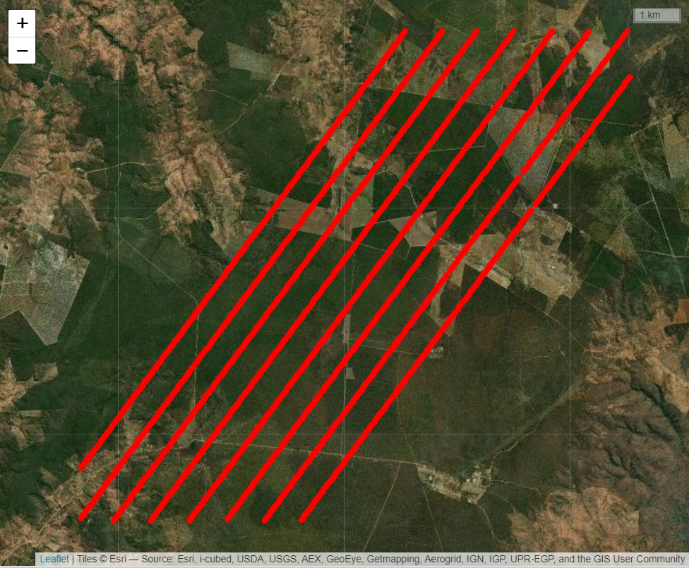
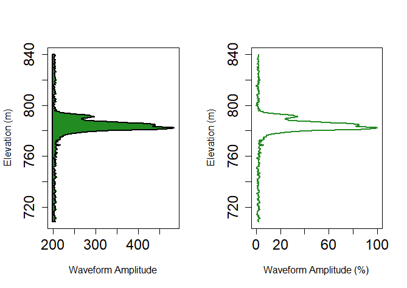
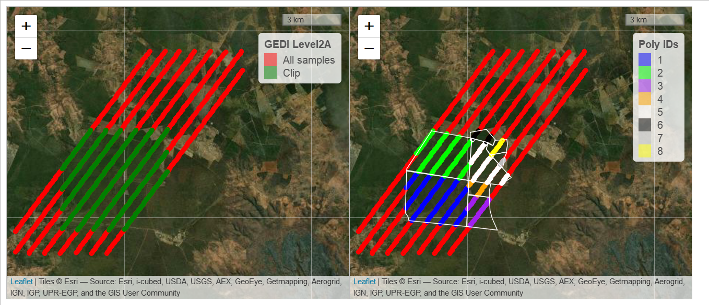
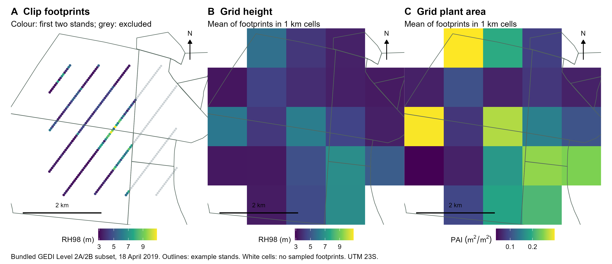
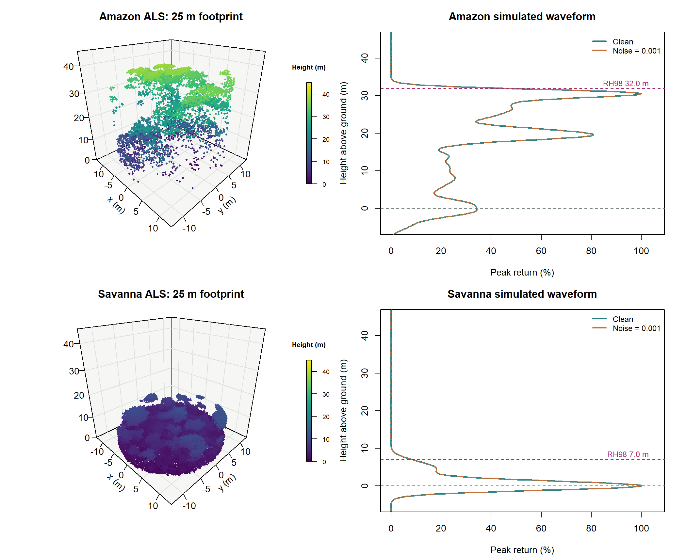
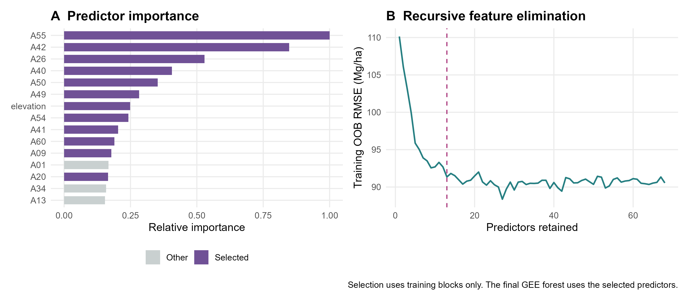
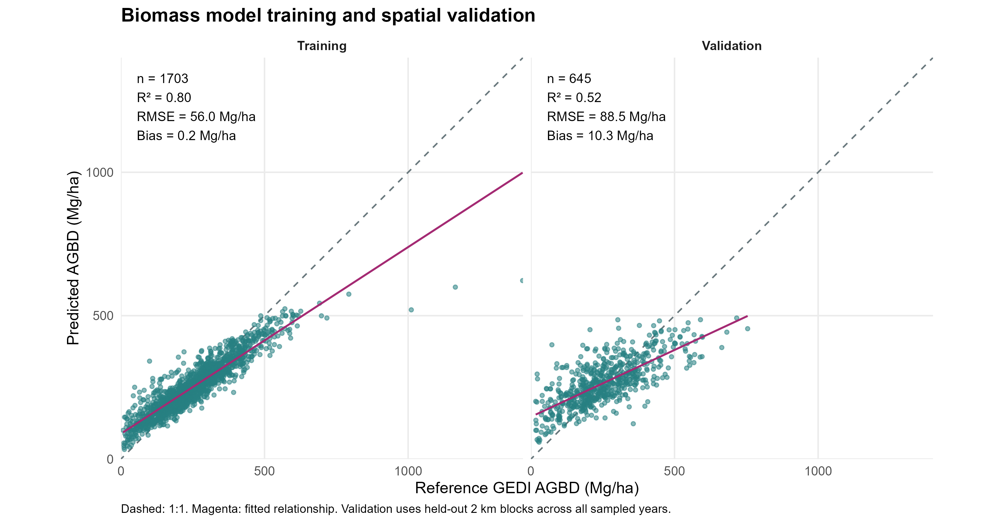
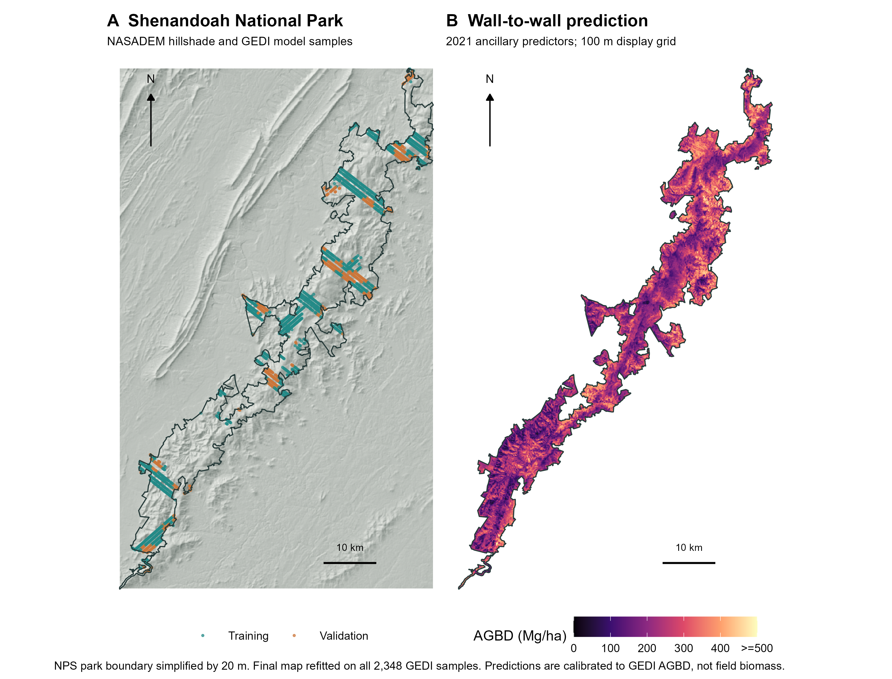

[](https://CRAN.R-project.org/package=rGEDI)
[](https://cran.r-project.org/package=rGEDI)


# Learn GEDI with rGEDI

GEDI is a laser instrument aboard the International Space Station. Each
measurement samples a footprint approximately 25 m across. Its waveform
records returned laser energy through the vegetation and down to the ground.
GEDI samples tracks; it does not measure every location in a landscape.

This tutorial follows those measurements from **Level 1B waveforms**, through
**Level 2A/2B vegetation metrics**, **Level 3 grids**, and **Level 4A/4B biomass**.
We then simulate GEDI waveforms from measured ALS data and combine GEDI with
other satellite data to make a wall-to-wall map.

## Before you start

The current tutorial uses the rGEDI 0.6.1 development API.

```r
install.packages("remotes")
remotes::install_github("carlos-alberto-silva/rGEDI")

library(rGEDI)
library(data.table)
library(sf)
library(terra)

outdir <- file.path(tempdir(), "rGEDI-tutorial")
dir.create(outdir, showWarnings = FALSE)
```

Bundled data support offline extraction, statistics and static plots.
Interactive imagery maps use `leaflet` and online tiles; ALS files use `lidR`.
The optional Earth Engine steps need
an authenticated project and Python dependencies configured by
`rGEDI_configure(install = TRUE)`.

## 1 Start with Level 1B waveforms

Level 1B contains geolocated waveforms. First open the small Cerrado example
distributed with the package.

```r
level1b_path <- unzip(system.file("extdata",
  "GEDI01_B_2019108080338_O01964_T05337_02_003_01_sub.zip",
  package = "rGEDI"), exdir = outdir)
level1b <- readLevel1B(level1b_path)

level1b_geo <- getLevel1BGeo(level1b)
head(level1b_geo[, .(shot_number, longitude_bin0, latitude_bin0)], 3)
```

```text
         shot_number longitude_bin0 latitude_bin0
               <i64>          <num>         <num>
1: 19640119100108615      -44.13999     -13.72638
2: 19640119300108616      -44.13967     -13.72596
3: 19640119500108617      -44.13936     -13.72555
```

### Plot the footprints

Coordinates tell us where the laser sampled. Plot them over imagery:

```r
footprint_map <- leaflet::leaflet(data = as.data.frame(level1b_geo)) |>
  leaflet::addProviderTiles("Esri.WorldImagery") |>
  leaflet::addCircleMarkers(
    lng = ~longitude_bin0, lat = ~latitude_bin0,
    radius = 2, color = "red", stroke = FALSE, fillOpacity = 1
  ) |>
  leaflet::addScaleBar(position = "topright",
    options = leaflet::scaleBarOptions(imperial = FALSE)) |>
  leaflet::addLegend(position = "topright", colors = "red",
    labels = "Samples", title = "GEDI Level 1B")
footprint_map
```

<p align="center"></p>

### Examine one waveform

The shot identifier connects a waveform to its footprint and higher-level
metrics. Keep shot identifiers as character or integer64 values.

```r
shot <- level1b_geo$shot_number[1]
waveform <- getLevel1BWF(level1b, shot_number = shot)
plot(waveform)
```

<p align="center"></p>

### Find additional granules

For your own area, search with a bounding box and date interval. Earthdata
downloads require an Earthdata account.

```r
study_area <- st_read(system.file("extdata", "stands_cerrado.shp",
                                  package = "rGEDI"), quiet = TRUE)
box <- st_bbox(study_area)
xmin <- unname(box["xmin"]); xmax <- unname(box["xmax"])
ymin <- unname(box["ymin"]); ymax <- unname(box["ymax"])

urls <- gedifinder("GEDI01_B", ul_lat = ymax, ul_lon = xmin,
  lr_lat = ymin, lr_lon = xmax, version = "002",
  daterange = c("2019-04-18", "2019-04-19"))
# earthdata_login()
# gediDownload(urls, outdir = outdir)
```

`gedifinder(orbit = "O01964", product = "GEDI02_A", version = "002")`
finds the four production granules for that orbit. `getTrack()` and
`plot_gedi_orbit_animation()` can display their time-ordered tracks.

<p align="center"></p>

## 2 Describe vegetation with Level 2A and Level 2B

Level 2A supplies ground elevation and relative-height metrics. RH98 is the
height associated with 98% of cumulative waveform energy, relative to the
estimated ground. Level 2B describes canopy cover, plant area index (PAI), and
plant area volume density (PAVD).

```r
level2a_path <- unzip(system.file("extdata",
  "GEDI02_A_2019108080338_O01964_T05337_02_001_01_sub.zip",
  package = "rGEDI"), exdir = outdir)
level2b_path <- unzip(system.file("extdata",
  "GEDI02_B_2019108080338_O01964_T05337_02_001_01_sub.zip",
  package = "rGEDI"), exdir = outdir)
level2a <- readLevel2A(level2a_path)
level2b <- readLevel2B(level2b_path)
level2a_metrics <- getLevel2AM(level2a)
level2b_vpm <- getLevel2BVPM(level2b)
head(level2a_metrics[, .(beam, shot_number, rh50, rh98, rh100)], 3)
```

```text
       beam       shot_number  rh50  rh98 rh100
     <char>             <i64> <num> <num> <num>
1: BEAM0001 19640119100108615 -0.14  3.25  4.30
2: BEAM0001 19640119300108616 -0.26  3.07  4.08
3: BEAM0001 19640119500108617 -0.26  3.22  4.41
```

```r
head(level2b_vpm[, .(beam, shot_number, pai, cover, fhd_normal)], 3)
```

```text
    beam       shot_number         pai       cover fhd_normal
   <int>             <i64>       <num>       <num>      <num>
1:     1 19640119100108615 0.056964017 0.028080121  1.3729203
2:     1 19640119300108616 0.003395777 0.001696448  0.6365142
3:     1 19640119500108617 0.037773777 0.018709604  1.4299893
```

### Connect height metrics to the waveform

```r
plotWFMetrics(level1b, level2a, shot_number = shot,
              rh = c(25, 50, 75, 90, 98))
```

<p align="center"></p>

### Explore vertical vegetation profiles

PAI describes plant area per ground area; PAVD describes its vertical
distribution. Extract the profiles before plotting a selected beam.

```r
pai_profile <- getLevel2BPAIProfile(level2b)
pavd_profile <- getLevel2BPAVDProfile(level2b)
profile_beam <- unique(pai_profile$beam)[1]
plotPAIProfile(pai_profile, beam = profile_beam)
plotPAVDProfile(pavd_profile, beam = profile_beam)
```

<p align="center"></p>

### Filter and clip the footprints

Choose quality criteria appropriate to the analysis. This local example
retains high-quality, undegraded nighttime measurements from power beams.

```r
power_beams <- c("BEAM0101", "BEAM0110", "BEAM1000", "BEAM1011")
level2a_good <- level2a_metrics[
  quality_flag == 1 & degrade_flag == 0 &
  sensitivity >= 0.9 & sensitivity <= 1 &
  solar_elevation < 0 & beam %in% power_beams
]
level2b_good <- level2b_vpm[l2b_quality_flag == 1 & sensitivity >= 0.9]

# Extracted tables return clipped tables.
bbox <- c(xmin, xmax, ymin, ymax)
level2a_bbox <- clip(level2a_metrics, bbox)
level2a_inside <- clip(level2a_metrics, study_area)

# Open HDF5 objects can instead be written as subset HDF5 files.
level2a_h5_clip <- clip(level2a, study_area,
  output = file.path(outdir, "level2a-clipped.h5"))
```

<p align="center"></p>

### Summarize each polygon

Use a polygon identifier to keep the summaries separate. Here cover is a
fraction, not a percentage.

```r
polygons <- study_area
polygons$unit_id <- seq_len(nrow(polygons))
footprints <- clip(level2b_good, polygons, split_by = "unit_id")
structure_metrics <- function(pai, cover) list(
  n = length(pai), mean_pai = mean(pai), mean_cover = mean(cover)
)
polygon_summary <- polyStatsLevel2BVPM(
  footprints, ~structure_metrics(pai, cover), id = "poly_id"
)
polygon_summary
```

```text
   poly_id     n   mean_pai mean_cover
     <int> <int>      <num>      <num>
1:       2    98 0.11910636 0.05553518
2:       1   100 0.15160601 0.06934074
3:       5    52 0.06078231 0.02914990
4:       4    20 0.25203198 0.11343149
5:       3    29 0.23915693 0.10965394
```

### Build your own footprint grids

`gridStatsLevel2AM()` and `gridStatsLevel2BVPM()` calculate user-defined
statistics. Their geographic resolution is in degrees.

```r
grid_summary <- function(x) list(
  min = min(x, na.rm = TRUE), max = max(x, na.rm = TRUE),
  mean = mean(x, na.rm = TRUE), sd = sd(x, na.rm = TRUE)
)
rh100_grid <- gridStatsLevel2AM(level2a_metrics,
  func = grid_summary(rh100), res = 0.005)
pai_grid <- gridStatsLevel2BVPM(level2b_vpm,
  func = grid_summary(pai), res = 0.005)
```

<p align="center"></p>

For an exact 1 km cell size, supply a projected template to `rasterize()`.
Choose a projection appropriate to your area; UTM 23S fits this example.

```r
points_utm <- terra::project(to_vect(level2a_metrics), "EPSG:32723")
bounds <- as.vector(terra::ext(points_utm))
bounds[c(1, 3)] <- floor(bounds[c(1, 3)] / 1000) * 1000
bounds[c(2, 4)] <- ceiling(bounds[c(2, 4)] / 1000) * 1000
template <- terra::rast(terra::ext(bounds), resolution = 1000,
                        crs = "EPSG:32723")
rh98_1km <- rGEDI::rasterize(level2a_metrics, "rh98",
  template = template, fun = "mean")
pai_1km <- rGEDI::rasterize(level2b_vpm, "pai",
  template = template, fun = "mean")
```

<p align="center"></p>

These grids summarize sampled footprints. White cells have no included
measurements; they are not zero-height vegetation.

## 3 Read and explore native Level 3 grids

NASA also distributes nominal 1 km Level 3 summaries. These are different
from the user-defined grids above. A small regional subset around Brasília,
Brazil, is bundled with its IBGE boundary so this example runs offline.

```r
level3_file <- system.file("extdata", "GEDI03_Brasilia.tif", package = "rGEDI")
level4b_file <- system.file("extdata", "GEDI04_B_Brasilia.tif", package = "rGEDI")
level3 <- readLevel3(level3_file)
level4b <- readLevel4B(level4b_file)
```

```text
    product  rows columns layers resolution_m
     <char> <num>   <num>  <num>        <num>
1:  Level 3    92     121      2     1000.895
2: Level 4B    92     121      2     1000.895
```

### Clip a grid to a mapped boundary

Transform the boundary to the raster's CRS before using its coordinates.
`clipLevel3()` accepts either an extent or a polygon.

```r
grid_aoi <- st_read(system.file("extdata", "brasilia.shp",
                                package = "rGEDI"), quiet = TRUE)
native_aoi <- st_transform(grid_aoi, terra::crs(level3))
grid_bbox <- as.vector(terra::ext(terra::vect(native_aoi)))
level3_bbox <- clipLevel3(level3, grid_bbox)
level3_aoi <- clipLevel3(level3, terra::vect(native_aoi))

plotLevel3(level3[["rh100_mean"]], main = "Level 3 mean RH100 (m)")
plotLevel3(level3_aoi[["rh100_mean"]], main = "Mean RH100 inside Brasilia")
```

<p align="center"></p>

### Extract pixel values

`getLevel3()` returns the native cell measurements intersecting the polygon.
`ID` identifies the input polygon; each row is an intersected cell.

```r
level3_values <- getLevel3(level3, geometry = terra::vect(native_aoi))
head(level3_values[is.finite(rh100_mean)], 3)
```

```text
      ID rh100_mean counts
   <num>      <num>  <num>
1:     1   9.303703     27
2:     1  11.421481     54
3:     1   9.538421     38
```

## 4 Move from structure to biomass with Level 4A and Level 4B

Level 4A estimates aboveground biomass density (AGBD) at footprints.
Level 4B provides gridded estimates and uncertainty information. Both use
Mg/ha, equivalent to metric tonnes per hectare.

### Level 4A footprints through Earth Engine

This optional online step introduces the new mapping area, Shenandoah
National Park. Its NPS boundary is supplied as a shapefile.

```r
# Configure Python dependencies once, if needed:
# rGEDI_configure(install = TRUE)
# Sys.setenv(EE_PROJECT = "your-authenticated-project")
ee <- ee_initialize(project = Sys.getenv("EE_PROJECT"))
aoi <- st_read(system.file("extdata", "shenandoah.shp", package = "rGEDI"),
               quiet = TRUE)
box <- st_bbox(aoi)
address <- gedifinder("GEDI04_A", ul_lat = box[["ymax"]],
  ul_lon = box[["xmin"]], lr_lat = box[["ymin"]], lr_lon = box[["xmax"]],
  version = "002.1", daterange = c("2019-05-01", "2019-10-01"), source = "gee")
level4a <- readLevel4A(address)
lazy <- getLevel4A(level4a, quality = TRUE, collect = FALSE)
lazy <- clip(lazy, aoi)  # Apply the polygon filter before transferring data.
biomass_footprints <- getLevel4A(lazy, quality = TRUE, max_features = 10000,
  cols = c("beam", "shot_number", "agbd", "agbd_se", "sensitivity",
           "solar_elevation", "l4_quality_flag", "degrade_flag"))
head(biomass_footprints[, .(beam, shot_number, agbd, agbd_se, sensitivity)], 3)
```

```text
    beam       shot_number     agbd  agbd_se sensitivity
   <int>            <char>    <num>    <num>       <num>
1:    11 43081100300231185 453.4523 10.32448    0.977248
2:    11 43081100300231211 366.5885 10.31399    0.979268
3:    11 43081100300231207 398.6888 10.31586    0.989330
```

The finder-reader-extractor sequence also supports Earthdata Cloud and
gediDB. Select `source = "earthdata"` or `source = "gedidb"` and the product
version provided by that service. GEE retains numeric beam identifiers;
its power beams are `5`, `6`, `8`, and `11`.

### Plot and clip Level 4B grids offline

Return to the bundled Brasília grids to compare regional biomass estimates
with the Level 3 structure metrics.

```r
level4b_bbox <- clipLevel4B(level4b, grid_bbox)
level4b_aoi <- clipLevel4B(level4b, terra::vect(native_aoi))
plotLevel4B(level4b[["MU"]], main = "Level 4B AGBD (Mg/ha)")
plotLevel4B(level4b_aoi[["MU"]], main = "AGBD inside Brasilia")
```

<p align="center"></p>

### Extract cells and calculate a polygon summary

```r
level4b_values <- getLevel4B(level4b, geometry = terra::vect(native_aoi))
head(level4b_values[is.finite(MU)], 3)
```

```text
      ID       MU        SE
   <num>    <num>     <num>
1:     1 26.18723 10.511335
2:     1 11.92644  2.939256
3:     1 21.65576  8.193736
```

```r
level4b_stats <- polyStats(level4b, terra::vect(native_aoi),
                           fun = mean, na.rm = TRUE)
level4b_stats
```

```text
      ID       MU       SE
   <int>    <num>    <num>
1:     1 17.22374 5.675005
```

`MU` is the mean AGBD estimate and `SE` is its cell-level standard error.
Here the summary averages the intersected cell values. The mean of the SE
values is not the uncertainty of the regional mean.

The corresponding clipping calls return:

```text
        output cells valid
        <char> <num> <num>
1:     L3 bbox  6324  5163
2:  L3 polygon  6324  4748
3:    L4B bbox  6324  5194
4: L4B polygon  6324  4807
```

## 5 Simulate GEDI waveforms from measured ALS

ALS resolves individual laser returns. `gediWFSimulator()` combines those
returns into a GEDI-like waveform at a chosen footprint location. The input
below is the original measured Amazon ALS example, not a random point cloud.
The package also includes `Savanna.laz`.

```r
als_file <- system.file("extdata", "Amazon.laz", package = "rGEDI")
als <- lidR::readLAS(als_file)
centre <- c(mean(range(als@data$X)), mean(range(als@data$Y)))

sim_clean <- gediWFSimulator(als, output = file.path(outdir, "sim-clean.h5"),
                            coords = centre, noise = 0, seed = 11)
sim_noisy <- gediWFSimulator(als, output = file.path(outdir, "sim-noisy.h5"),
                            coords = centre, noise = 0.001, seed = 11)
metrics_clean <- gediWFMetrics(sim_clean, rhRes = 1, ground_method = "lowest_peak")
metrics_noisy <- gediWFMetrics(sim_noisy, rhRes = 1, ground_method = "lowest_peak")
sim_waveform <- getLevel1BWF(sim_clean, metrics_clean$shot_number[1])
plot(sim_waveform, relative = TRUE)
```

<p align="center"></p>

Repeating these calls for both measured clouds gives:

```text
      site noise     cover       rh50      rh90      rh98 rh100 waveEnergy
    <char> <num>     <num>      <num>     <num>     <num> <num>      <num>
1:  Amazon 0.000 0.7795247 20.0403346 30.525283 31.963053 36.15   1.000000
2:  Amazon 0.001 0.7767196 20.0361180 30.535343 31.995403 70.95   1.002188
3: Savanna 0.000 0.1565774  0.4287428  4.700784  7.047970 13.05   1.000000
4: Savanna 0.001 0.1549919  0.4276787  4.759650  7.226346 47.85   1.007346
```

Waveform heights use the estimated ground; ALS display heights use each
cloud's minimum elevation. Notice how noise affects RH100 more than RH98.
Ground estimation and the waveform noise window matter when interpreting
these metrics.

## 6 Integrate GEDI and other sensors for wall-to-wall mapping

GEDI footprints provide training observations, while spatially continuous
satellite and terrain predictors allow a model to estimate unsampled cells.
This example maps biomass in Shenandoah National Park using annual AlphaEarth
satellite embeddings and NASADEM terrain variables accessed through rGEDI.

### See global GEDI data through GEE

A small display preview of the native Level 4B product illustrates global
coverage without transferring the footprint archive.

```r
global_address <- gedifinder("GEDI04_B", ul_lat = 52, ul_lon = -180,
  lr_lat = -52, lr_lon = 180, version = "002", source = "gee")
global_biomass <- readLevel4B(global_address, metrics = "MU")
map_view(list(AGBD = global_biomass),
  vis = list(AGBD = list(min = 0, max = 400,
    palette = c("#000004", "#721F81", "#F1605D", "#FCFDBF"))))
```

<p align="center"></p>

The figure uses a 20 km nearest-neighbour display preview. It is not a newly
estimated global biomass raster. The underlying product has its own sampling
support, period and uncertainty.

### Run the complete mapping example

The optional script retrieves May–September observations for 2019, 2021 and
2022, filters quality and nighttime power beams, clips them to the park, and
extracts year-matched predictors. It caches intermediate data outside the
package. Choose a cache folder on a drive with space.

```r
# Windows example; choose a suitable location for your computer:
# Sys.setenv(RGEDI_EXAMPLE_CACHE = "D:/rGEDI_package_examples")
source("readme/build-gee-tutorial.R")
source("readme/plot-gee-tutorial.R")
```

The following steps explain the main calls in that script.

### Extract ancillary predictors

For each acquisition year, build an annual predictor stack and extract its
values at the screened GEDI footprints. Preserve coordinates with a sample
identifier because GEE sampling returns feature properties.

```r
stack <- ee_build_AlphaEarth_embedding_terrain_stack(
  aoi, start_year = 2019, end_year = 2019, add_lonlat = FALSE)
biomass_footprints <- biomass_footprints[
  is.finite(agbd) & agbd >= 0 & sensitivity >= 0.9 & sensitivity <= 1 &
  solar_elevation < 0 & beam %in% c(5, 6, 8, 11)]
biomass_footprints[, sample_id := seq_len(.N)]
coordinates <- biomass_footprints[, .(sample_id, lon_lowestmode, lat_lowestmode)]
ancillary <- extractEE(stack, biomass_footprints, scale = 30, chunk_size = 1000)
ancillary <- merge(ancillary, coordinates, by = "sample_id", all.x = TRUE)
```

The complete script repeats this extraction by year, represents aspect with
sine and cosine, and uses `sample(..., spacedSampling(...))` to limit spatial
clustering. It retains 2,348 complete records for the displayed run.

### Separate validation blocks before selecting variables

Use the saved preparation results to repeat the model steps. All observations
from a 2 km block remain in the same partition across years.

```r
cache <- Sys.getenv("RGEDI_EXAMPLE_CACHE",
                    file.path(tempdir(), "rGEDI-package-examples"))
inputs <- readRDS(file.path(cache, "shenandoah_model_inputs.rds"))
data <- as.data.table(inputs$training)
train <- data[!block %in% inputs$heldout_blocks]
valid <- data[block %in% inputs$heldout_blocks]
predictor_names <- c(sprintf("A%02d", 0:63), "elevation", "slope",
                     "aspect_sin", "aspect_cos")
selection <- varSel(train[, ..predictor_names], train$agbd,
  method = "rfe", threshold = 0, seed = 726, ntree = 150, nodesize = 5)
selected <- selection$selvars
```

<p align="center"></p>

The displayed run retains 13 predictors. Out-of-bag error guides selection
within the training data; the held-out blocks are reserved for evaluation.

### Train and validate the GEE forest

Use the selected predictors to train the Earth Engine regression forest.
Classify held-out feature properties to evaluate the same server-side model.

```r
model_fields <- c("lon_lowestmode", "lat_lowestmode", "sample_id", "agbd", selected)
training_ee <- vect_as_ee(to_vect(train[, ..model_fields]))
model <- build_ee_forest(training_ee, response = "agbd", predictors = selected,
                         trees = 500, seed = 726)
validation_ee <- vect_as_ee(to_vect(valid[, ..model_fields]))
validation_ee <- validation_ee$classify(model, "predicted")
```

The full script collects these predictions and evaluates them with
`fit_metrics()`. Predictive R² below is calculated as one minus the residual
sum of squares divided by the observed total sum of squares.

```text
        stage     n    R2  RMSE  bias
       <fctr> <int> <num> <num> <num>
1:   Training  1703 0.799 56.03  0.16
2: Validation   645 0.516 88.47 10.34
```

<p align="center"></p>

The reference response is GEDI AGBD, so this measures agreement with withheld
GEDI estimates. Independent field data are needed to evaluate field biomass.

### Predict the whole park

After evaluation, the complete script refits the selected model on all 2,348
records. It applies that model to the 2021 predictor stack and exports a
100 m demonstration map. The stack includes the same aspect transformations
used during training.

```r
stack <- ee_build_AlphaEarth_embedding_terrain_stack(aoi, 2021, 2021,
                                                   add_lonlat = FALSE)
aspect <- stack$select("aspect")$multiply(pi / 180)
stack <- stack$addBands(aspect$sin()$rename("aspect_sin"))$
  addBands(aspect$cos()$rename("aspect_cos"))
all_training <- vect_as_ee(to_vect(data[, ..model_fields]))
final_model <- build_ee_forest(all_training, "agbd", selected, trees = 500, seed = 726)
mapped <- map_create(final_model, stack$select(as.list(selected)),
                     aoi = aoi, name = "AGBD")
map_view(list(AGBD = mapped),
  vis = list(AGBD = list(min = 0, max = 500,
    palette = c("#000004", "#721F81", "#F1605D", "#FCFDBF"))), aoi = aoi)
map_download(mapped, file.path(outdir, "shenandoah_agbd_2021.tif"),
              region = aoi, scale = 100, crs = "EPSG:32617")
```

<p align="center"></p>

This is a model prediction between sampled footprints. It is not an
additional GEDI observation or the native NASA Level 4B product.

## Close HDF5 connections

```r
close(level1b)
close(level2a)
close(level2b)
close(level2a_h5_clip)
close(sim_clean)
close(sim_noisy)
```

## Reproduce the displayed outputs

Run scripts from the repository root after installing their plotting
dependencies. The local scripts use bundled data; the cloud script is optional.

```r
# install.packages(c("lidR", "plot3D", "patchwork", "viridisLite", "rnaturalearthdata"))
source("readme/build-tutorial-local.R")    # Waveforms, measured ALS and R output
source("readme/build-package-spatial.R")   # Footprint clipping and user grids
source("readme/build-tutorial-rasters.R")  # Native Level 3/4B plots and output
# source("readme/build-gee-tutorial.R")    # Requires GEE; downloads and models
# source("readme/plot-gee-tutorial.R")     # Draw the saved cloud results
```

All figures and data here are package tutorial examples. Data-source and
subset details are recorded in `inst/extdata/EXAMPLE_DATA.txt`.

## Acknowledgements and funding

GEDI data are provided by NASA's LP DAAC and ORNL DAAC. Steven Hancock
developed the GEDI waveform simulator; rGEDI builds on his
[reference implementation](https://bitbucket.org/StevenHancock/gedisimulator/src/master/).
Example boundaries are from [IBGE](https://servicodados.ibge.gov.br/api/docs/malhas?versao=3)
and the [National Park Service](https://www.nps.gov/subjects/gisandmapping/npmap.htm).

This work was primarily supported by NASA’s ICESat-2 Science Team
(80NSSC23K0941), Carbon Monitoring System (80NSSC23K1257), and Commercial
Smallsat Data Scientific Analysis program (80NSSC24K0055); the
McIntire–Stennis Program at the University of Florida (Accession No. 7005758);
and the Joint Fire Science Program through the EMS4D project (22-2-02-15).

## Cite rGEDI

```r
citation("rGEDI")
```

Silva, C. A., and Hamamura, C. *rGEDI: NASA's Global Ecosystem Dynamics
Investigation (GEDI) Data Visualization and Processing*. R package.
[CRAN package DOI](https://doi.org/10.32614/CRAN.package.rGEDI).

## Questions and issues

Report reproducible problems at the
[issue tracker](https://github.com/carlos-alberto-silva/rGEDI/issues), including
the package version, operating system, product/version and minimal example.
Keep credentials out of reports. rGEDI is an independent open-source project,
not an official NASA software product.
